# Лабораторная 1 - Полный мониторинг маленького сервиса

---

Лясин Илья (466570)
K3321

---

## Цель

Сделать маленький простой сервис и поднять для него полный мониторинг: метрики, логи и трейсы.
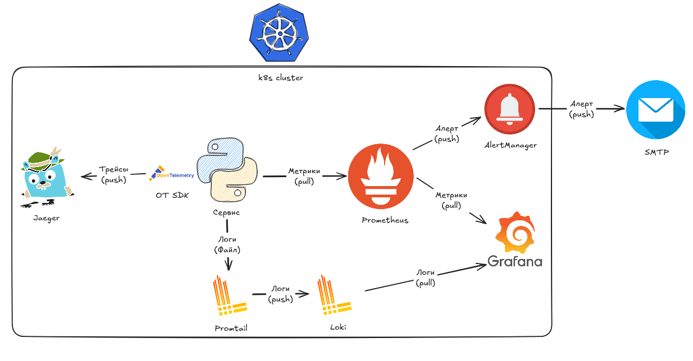

## Подготовка

Для выполнения этой и последующих лаб было решено разворачивать инфраструктуру в Kubernetes, поднятого через minikube.
Для комфортной работы, учитывая требовательность к оперативной памяти, я поднял виртуалку (ubuntu server) на ноутбуке, а саму лабу буду делать с ПК. Виртуалка использует тип подключения `сетевой мост`, т.е. как будто у меня локально стоит отдельный сервер со своим IP.
На виртуалке установил Docker и Minikube, следуя инструкциям из документаций. (https://docs.docker.com/engine/install/ubuntu/, https://minikube.sigs.k8s.io/docs/start/?arch=%2Flinux%2Fx86-64%2Fstable%2Fbinary+download).

Запустил Minikube используя Docker как движок, а не виртуализацию, поскольку вложенная виртуализация не кажется особо надежной и более требовательна.

`minikube start --driver=docker`

По умолчанию minikube доступен только локально, открыть доступ к управлению кластером извне стандартными методами нельзя, поэтому пробросим порты через SSH:

`ssh -L 8443:192.168.49.2:8443 myuser@192.168.0.138`

- 192.168.49.2:8443 - адрес api-server;
- 192.168.0.138 - IP локального сервера.

Теперь скопируем конфиг для кубера с сервера на пк, заменив некоторые поля:

```yaml
apiVersion: v1
clusters:
- cluster:
    # Отключим проверку сертификата
    insecure-skip-tls-verify: true
    extensions:
    - extension:
        last-update: Fri, 04 Sep 2026 17:15:44 UTC
        provider: minikube.sigs.k8s.io
        version: v1.39.0
      name: cluster_info
    # Локальный адрес т.к. проброшены порты до локалки
    server: https://localhost:8443 
  name: minikube
contexts:
- context:
    cluster: minikube
    extensions:
    - extension:
        last-update: Fri, 04 Sep 2026 17:15:44 UTC
        provider: minikube.sigs.k8s.io
        version: v1.39.0
      name: context_info
    namespace: default
    user: minikube
  name: minikube
current-context: minikube
kind: Config
users:
- name: minikube
  user:
    client-certificate-data: ...
    client-key-data: ...
```

> [!WARNING]
> TLS отключен только потому что устройство находится в моей локальной сети и весь трафик идёт по зашифрованному SSH тунелю
> В реальности так делать не стоит.

Теперь у меня есть доступ к кластеру и можно перейти к выполнению лабы.

```bash
eliassen@FSDGSD:~$ kubectl get nodes
NAME       STATUS   ROLES           AGE   VERSION
minikube   Ready    control-plane   15h   v1.37.0
```


## Сервис

Используя технологии вайб-кодинга был разработан сервис для тестирования мониторинг-инфраструктуры. API содержит следующие endpoint'ы:

- `/error` - Возвращает ошибку 500, увеличивая счётчик ошибок;
- `/delay` - На сервере возникает задержка 1-3 секунды перед ответом, тем самым повышается latency;
- `/load` - При вызове сервер создает 50 запросов к самому себе, повышая показатель Requests Per Second;
- `/health` - Проверка доступности сервиса;
- `/metrics` - Метрики сервиса.

API написан на Python+FastApi, в качестве главной страницы выступает встроенный в FastApi Swagger.
Логи выводятся в формате JSON, имеют различные уровни значимости.
Собираются следующие метрики:
- Количество HTTP запросов;
- Количество ошибок на стороне сервера (5XX);
- Гистограмма времени выполнения запросов.

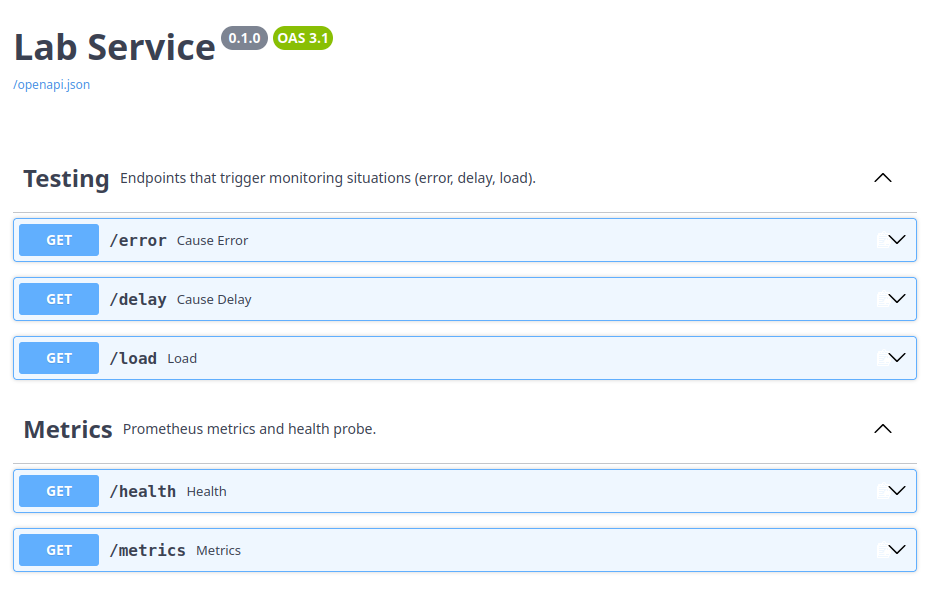

Образ залил на GitHub, откуда он будет впоследствии подтягиваться в кластер `https://github.com/users/7eliassen/packages/container/package/monitoring-lab`

Теперь необходимо создать chart, через который будет запускаться наш сервис:

```bash
$ helm create monitoring-lab-chart
Creating monitoring-lab-chart
```

Удалим лишние файлы и получим следующую структуру:

```
monitoring-lab-chart
├── Chart.yaml - метаданные чарта
├── templates - папка с шаблонами манифестов, куда будут подставляться значения values.yaml
│   ├── api-deployment.yaml
│   ├── api-service.yaml
└── values.yaml - файл с настройками чарта
```

`Chart.yaml`
```yaml
apiVersion: v2
name: monitoring-lab
description: A Helm chart for monitoring lab
type: application
version: 0.1.0
```

`values.yaml`
```yaml
labService:
  image:
    repository: ghcr.io/7eliassen/monitoring-lab
    tag: "1.0.0"
    pullPolicy: IfNotPresent
  # Используем версию приложения в качестве тега + политику IfNotPresent, чтобы не подтягивать образ каждый раз

  # Задаем, на каком порту ноды будет доступно наше приложение
  service:
    port: 8000
    nodePort: 30080

  replicaCount: 1
```

Вместо стандартных k8s манифестов используем шаблонизирование, подставляя наши значения `values.yaml`:

`api-deployment.yaml`
```yaml
apiVersion: apps/v1
kind: Deployment
metadata:
  name: "{{ .Release.Name }}-api"
  labels:
    app: api
    release: "{{ .Release.Name }}"
spec:
  replicas: {{ .Values.labService.replicaCount }}
  selector:
    matchLabels:
      app: api
      release: "{{ .Release.Name }}"
  template:
    metadata:
      labels:
        app: api
        release: "{{ .Release.Name }}"
    spec:
      containers:
      - name: api
        image: "{{ .Values.labService.image.repository }}:{{ .Values.labService.image.tag }}"
        imagePullPolicy: {{ .Values.labService.image.pullPolicy }}
        ports:
        - containerPort: {{ .Values.labService.service.port }}
```

`api-service.yaml`
```yaml
apiVersion: v1
kind: Service
metadata:
  name: "{{ .Release.Name }}-api"
  labels:
    app: api
    release: "{{ .Release.Name }}"
spec:
  type: NodePort
  selector:
    app: api
    release: "{{ .Release.Name }}"
  ports:
    - port: {{ .Values.labService.service.port }}
      targetPort: {{ .Values.labService.service.port }}
      nodePort: {{ .Values.labService.service.nodePort }}
```

> [!NOTE]
> Доступ ко всем компонентам я получаю через port-forwarding, но всеравно создаю NodePort сервисы для тех приложений, чей UI должен быть доступен извне. 

Пробуем установить чарт:
```bash
$ helm install monitoring-lab ./monitoring-lab-chart
NAME: monitoring-lab
LAST DEPLOYED: Mon Sep 28 18:39:12 2026
NAMESPACE: default
STATUS: deployed
REVISION: 1
DESCRIPTION: Install complete
TEST SUITE: None
```

Как видно, приложение запустилось в кластере:
```bash
$ kubectl get all
NAME                                      READY   STATUS    RESTARTS   AGE
pod/monitoring-lab-api-677fcd97d7-7w25s   1/1     Running   0          2m33s

NAME                         TYPE        CLUSTER-IP      EXTERNAL-IP   PORT(S)          AGE
service/kubernetes           ClusterIP   10.96.0.1       <none>        443/TCP          23d
service/monitoring-lab-api   NodePort    10.105.162.77   <none>        8000:30080/TCP   2m34s

NAME                                 READY   UP-TO-DATE   AVAILABLE   AGE
deployment.apps/monitoring-lab-api   1/1     1            1           2m34s

NAME                                            DESIRED   CURRENT   READY   AGE
replicaset.apps/monitoring-lab-api-677fcd97d7   1         1         1       2m34s
```

## Метрики (Prometheus + Grafana)

Теперь необходимо настроить сбор и отображение метрик. 


Начнём с поднятия Prometheus. Для этого создадим файлы `prometheus-deployment.yaml`, `prometheus-service.yaml` и `prometheus-configmap` в директории `/templates`.

`prometheus-deployment.yaml`:
```yaml
apiVersion: apps/v1
kind: Deployment
metadata:
  name: "{{ .Release.Name }}-prometheus"
  labels:
    app: prometheus
    release: "{{ .Release.Name }}"
spec:
  replicas: 1
  selector:
    matchLabels:
      app: prometheus
      release: "{{ .Release.Name }}"
  template:
    metadata:
      labels:
        app: prometheus
        release: "{{ .Release.Name }}"
    spec:
      containers:
        - name: prometheus
          image: prom/prometheus:v3.15.0
          # Передаем путь до конфига в качестве аргумента
          args:
            - "--config.file=/etc/prometheus/prometheus.yml"
          ports:
            # Открываем стандартный prometheus порт
            - name: http
              containerPort: 9090
          volumeMounts:
            # Монтируем том как файл
            - name: prometheus-config
              mountPath: /etc/prometheus/prometheus.yml
              subPath: prometheus.yml # Из подключенного тома взять только ключ prometheus.yml
          readinessProbe:
            httpGet:
              path: /-/ready
              port: http
          livenessProbe:
            httpGet:
              path: /-/healthy
              port: http
      volumes:
      # Добавляем ConfigMap том
        - name: prometheus-config
          configMap:
            name: "{{ .Release.Name }}-prometheus-config"
```

`service.yaml`:
```yaml
apiVersion: v1
kind: Service
metadata:
  name: "{{ .Release.Name }}-prometheus"
  labels:
    app: prometheus
    release: "{{ .Release.Name }}"
spec:
  selector:
    app: prometheus
    release: "{{ .Release.Name }}"
  ports:
    - name: http
      port: 9090
      targetPort: http
```

В данном service мы используем тип ClusterIP, поскольку prometheus нужен для компонентов внутри кластера и для него не требуется доступ извне.


Далее добавим конфиг для Prometheus. В нём необходимо прописать, как и откуда он должен собирать метрики.
`prometheus-configmap.yaml`:
```yaml
apiVersion: v1
kind: ConfigMap
metadata:
  name: "{{ .Release.Name }}-prometheus-config"
data:
  # Значение данного ключа будет подставлено в файл /etc/prometheus/prometheus.yml в контейнере prometheus'а
  prometheus.yml: |
    global:
      scrape_interval: 5s

    scrape_configs: # Настраиваем, откуда будут собираться метрики
      - job_name: 'api'
        static_configs:
          - targets: ['{{ .Release.Name }}-api:{{ .Values.labService.service.port }}'] # Снова используем возможности Helm и подставляем адрес нашего сервиса
```

Обновляем чарт:
```bash
$ helm upgrade monitoring-lab  monitoring-lab-chart/
Release "monitoring-lab" has been upgraded. Happy Helming!
NAME: monitoring-lab
LAST DEPLOYED: Mon Sep 28 19:48:38 2026
NAMESPACE: default
STATUS: deployed
REVISION: 4
DESCRIPTION: Upgrade complete
TEST SUITE: None
```

Пробрасываем порты до prometheus'а и проверяем, что он собирает метрики:
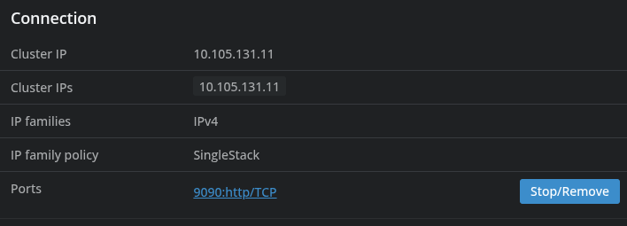

Несколько раз вызываем `error/` на нашем сервисе и выполняем запрос `http_errors_total` в Prometheus:
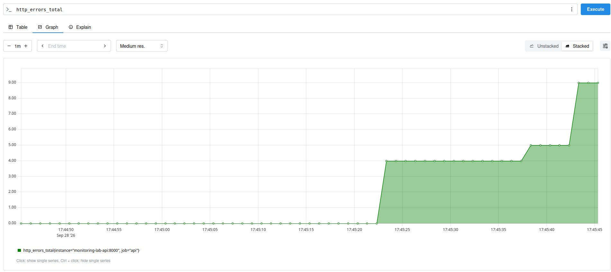

Далее необходимо поднять Grafana, чтобы отображать метрики более удобным способом.

Создадим файлы `grafana-deployment.yaml`, `grafana-service.yaml`.

В файле `grafana-deployment.yaml` необходимо добавить конфиги, чтобы не настраивать Grafana вручную:
```yaml
apiVersion: apps/v1
kind: Deployment
metadata:
  name: "{{ .Release.Name }}-grafana"
  labels:
    app: grafana
    release: "{{ .Release.Name }}"
spec:
  replicas: 1
  selector:
    matchLabels:
      app: grafana
      release: "{{ .Release.Name }}"
  template:
    metadata:
      labels:
        app: grafana
        release: "{{ .Release.Name }}"
    spec:
      containers:
        - name: grafana
          image: "grafana/grafana:{{ .Values.grafana.image.tag }}"
          ports:
            - name: http
              containerPort: 3000
          volumeMounts:
            - name: grafana-datasources # Настройка подключения к Prometheus
              mountPath: /etc/grafana/provisioning/datasources
            - name: grafana-dashboard-provider # Настраиваем откуда будут браться dashboard'ы
              mountPath: /etc/grafana/provisioning/dashboards
            - name: grafana-dashboard # Подключаем сами дашборды
              mountPath: /var/lib/grafana/dashboards
      volumes:
        - name: grafana-datasources
          configMap:
            name: "{{ .Release.Name }}-grafana-datasources"
        - name: grafana-dashboard-provider
          configMap:
            name: "{{ .Release.Name }}-grafana-dashboard-provider"
        - name: grafana-dashboard
          configMap:
            name: "{{ .Release.Name }}-grafana-dashboard"
```


- `grafana-datasources`: 

```yaml
apiVersion: v1
kind: ConfigMap
metadata:
  name: "{{ .Release.Name }}-grafana-datasources"
data:
  prometheus.yaml: |
    apiVersion: 1

    datasources:
      - name: Prometheus
        uid: prometheus
        type: prometheus
        access: proxy
        url: http://{{ .Release.Name }}-prometheus:9090
        isDefault: true
        editable: false
```

Здесь необходимо прописать настройки для подключения к prometheus

Для автоматической загрузки дашбордов создадим provider. Он указывает Grafana,
в какой директории искать JSON-файлы дашбордов:

`grafana-dashboard-provider-configmap.yaml`
```yaml
apiVersion: v1
kind: ConfigMap
metadata:
  name: "{{ .Release.Name }}-grafana-dashboard-provider"
data:
  provider.yaml: |
    apiVersion: 1

    providers:
      - name: default
        orgId: 1
        folder: Monitoring
        type: file
        disableDeletion: false
        allowUiUpdates: false
        updateIntervalSeconds: 30
        options:
          path: /var/lib/grafana/dashboards
```

Сам дашборд хранится в ConfigMap `grafana-dashboard-configmap.yaml`.
Внутри ключа `api-monitoring.json` находится JSON, экспортированный из Grafana:

```yaml
apiVersion: v1
kind: ConfigMap
metadata:
  name: "{{ .Release.Name }}-grafana-dashboard"
data:
  api-monitoring.json: |
    {
      "apiVersion": "dashboard.grafana.app/v2",
      "kind": "Dashboard",
      "metadata": {
        "name": "api-monitoring"
      },
      "spec": {
        // JSON-модель дашборда, экспортированная из Grafana
      }
    }
```

Полный JSON дашборда находится в файле
`monitoring-lab-chart/templates/grafana-dashboard-configmap.yaml`.

Чтобы открыть веб-интерфейс Grafana из-за пределов кластера, используется
Service типа `NodePort`:

`grafana-service.yaml`
```yaml
apiVersion: v1
kind: Service
metadata:
  name: "{{ .Release.Name }}-grafana"
  labels:
    app: grafana
    release: "{{ .Release.Name }}"
spec:
  type: NodePort
  selector:
    app: grafana
    release: "{{ .Release.Name }}"
  ports:
    - name: http
      port: 3000
      targetPort: http
      nodePort: {{ .Values.grafana.service.nodePort }}
```

В результате Grafana доступна по адресу `http://<NodeIP>:30030`.

Так выглядит подключенный dashboard. Тут 3 графика: Частота запросов, доля ошибок и задержка запросов (по 95 перцентилю).

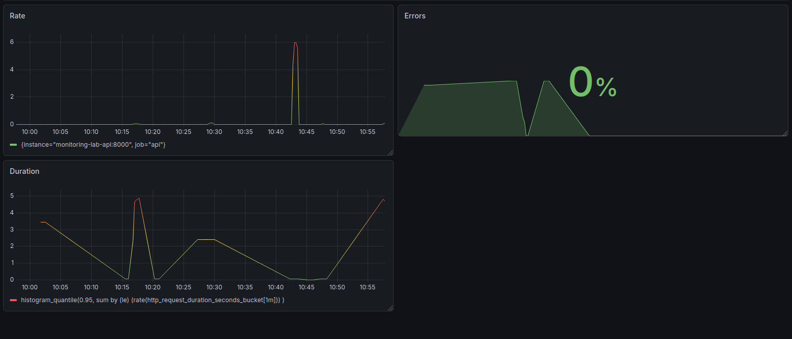


Я заметил, что даже в моменты, когда никаких запросов не было, график Rate указывает, что какой-то трафик идёт. Как оказалось это связано с тем, что наш сервис учитывает запросы к `metrics/` в метрике `http_total_requests`. Поэтому необходимо убрать запросы `metrics/` и `health/` из учета в метриках, чтобы не засорять графики. Делегируем эту задачу программисту и обновим образ:
```bash
$ docker build -t ghcr.io/7eliassen/monitoring-lab:1.0.1 .
[+] Building 6.3s (10/10) FINISHED        docker:default
... 

$ docker push ghcr.io/7eliassen/monitoring-lab:1.0.1
The push refers to repository [ghcr.io/7eliassen/monitoring-lab]
...
1.0.1: digest: sha256:36a01b00e870c51a123c0572c6a8fe6e4905ace989d658aca2352197b6aee83a size: 856
```

В `Values.yaml` изменим значение `image.tag` на 1.0.1 и обновим чарт:
```bash
$ helm upgrade monitoring-lab ./monitoring-lab-chart/
Release "monitoring-lab" has been upgraded. Happy Helming!
NAME: monitoring-lab
LAST DEPLOYED: Wed Sep 30 09:45:56 2026
NAMESPACE: default
STATUS: deployed
REVISION: 11
DESCRIPTION: Upgrade complete
TEST SUITE: None
```

Теперь проверим, что графики корректно отображаются. Начнём с показателя ошибок. Подождём пока количество запросов за последнюю минуту равно 0 и попробуем вызвать `error/`:
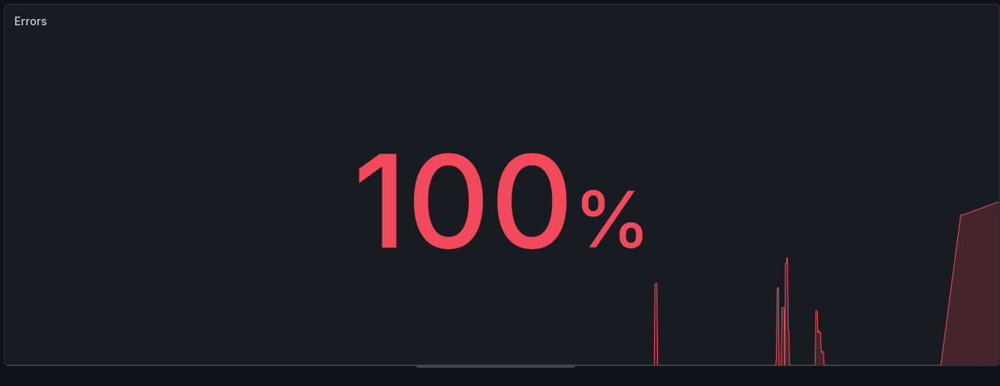

Поскольку это был единственный запрос, то логично, что количество ошибок = 100%. Снова подождём и вызовем 3 раза `delay/` и один раз `error/`:
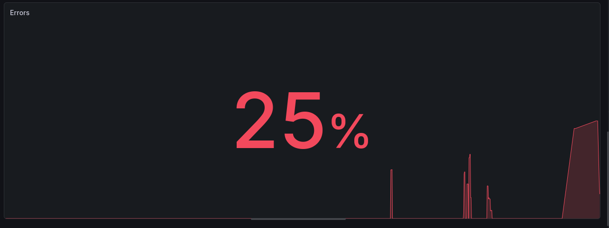
Как видно, доля ошибок отображается правильно 👍.

Теперь проверим Rate. Чтобы увеличить RPS, достаточно вызвать `load/`:

> [!NOTE]
> Тут возникла проблема, что вызовы `/`  не увеличивали метрику `http_total_requests`, из-за чего вызов `load/` не повышал нагрузку на сервер. Поэтому сервис обновился до 1.0.2

Несколько раз вызовем `load/` и видим такой график:
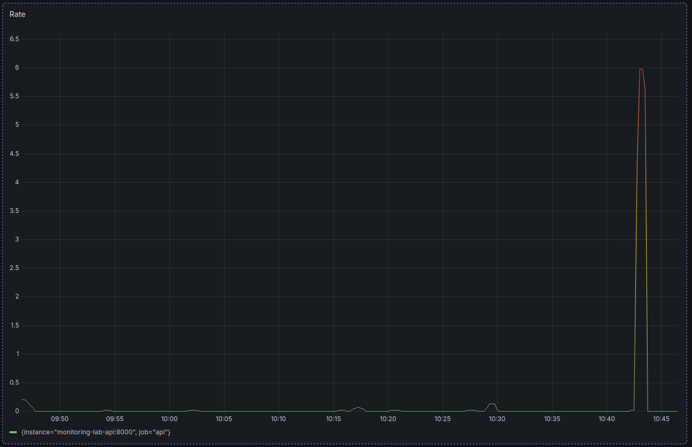

И наконец вызовем несколько раз `delay/`, повысив значение duration (10:57):
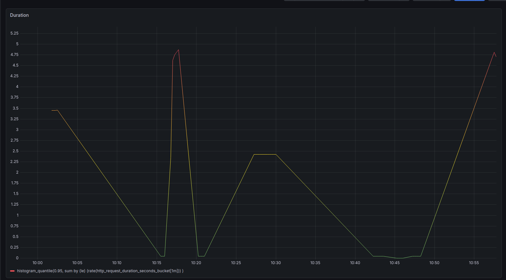

Все показатели содержат корректные значения и правильно отображаются на графиках.

## Логи (Loki + Promtail → Grafana)

Метрики готовы. Теперь нужно настроить 2 столп observability - логи. Логи - это текстовые данные, которые сообщают о произошедших событиях в системе.

В данной лабе мы используем стек Promtail - Loki - Grafana. 

- Promtail - читает логи с output сервиса (в нашем случае логи pod'а), добавляет к ним метки (labels) и отправляет в Loki.
- Loki - агрегатор логов, сюда присылаются логи с Promtail. Они сжимаются, индексируются и хранятся здесь. Это что-то вроде Prometheus, но для логов.
- Grafana - помимо метрик тут можно и логи читать.

Попробуем для начала поднять Loki, а потом разбираться с конфигурацией.

> [!NOTE]
> Тут я понял, что файлов в monitoring-lab-chart/templates/ становится слишком много и распределил манифесты по папкам для каждого сервиса.   

Для Grafana и Prometheus я сам писал манифесты, используя официальные образы контейнеров. Но поскольку я использую Helm, то есть возможность облегчить процесс установки компонентов в кубер. Воспользуемся готовыми чартами, чтобы поднять Loki.

Возьмем конфиг с документации (https://grafana.com/docs/loki/latest/setup/install/helm/install-monolithic/) и немного отредактировав, добавим в `Values.yaml`:

```yaml
...
loki:
  # Запускаем локи в монолитном режиме с минимальной конфигурацией. Для лабы нам не нужна сложная инфраструктура
  deploymentMode: Monolithic
  persistence:
    enabled: false # Т.к. не нужно сохранять логи между перезапусками, этот параметр можно отключить
  singleBinary:
    replicas: 1
  gateway:
    enabled: false
  chunksCache:
    enabled: false
  resultsCache:
    enabled: false
  lokiCanary:
    enabled: false
  test:
    enabled: false
  minio:
    enabled: false
  backend:
    replicas: 0
  read:
    replicas: 0
  write:
    replicas: 0

  loki:
    auth_enabled: false # Авторизация не нужна
    commonConfig:
      replication_factor: 1
    storage:
      type: filesystem # Используем fs pod'а для хранения логов
    schemaConfig:
      configs:
        - from: "2024-04-01"
          store: tsdb
          object_store: filesystem
          schema: v13
          index:
            prefix: loki_index_
            period: 24h
    limits_config:
      allow_structured_metadata: true
      volume_enabled: true
```

Аналогично поднимем Promtail используя готовый чарт.
> [!WARNING]
> Promtail более не поддерживается и chart который будет использоваться тоже deprecated. Для лабы пойдет, но для прода нужно искать альтернативу.

`Chart.yaml`
```yaml

dependencies:
  ...
  - name: promtail # Deprecated!!!
    version: "6.17.1"
    repository: https://grafana.github.io/helm-charts
```

`Values.yaml`
```yaml
promtail:
  config:
    clients:
      - url: http://monitoring-lab-loki:3100/loki/api/v1/push # В отличие от Prometheus, Promtail сам отправляет логи в Loki
```

Promtail запускается как DaemonSet и собирает логи со всех pod'ов на той ноде, где запущен. Текущей конфигурации достаточно, т.к. по умолчанию Promtail собирает логи со всех подов в т.ч. с pod'а нашего сервиса.

Подключим Loki как datasource в Grafana:
`templates/grafana/datasource-configmap.yaml`
```yaml

    datasources:
      ...
      - name: Loki
        uid: loki
        type: loki
        access: proxy
        url: http://{{ .Release.Name }}-loki:3100
        isDefault: false
        editable: false
```

Теперь нужно установить зависимости и обновить наш чарт:
```bash
$ helm dependency update
Getting updates for unmanaged Helm repositories...
...Successfully got an update from the "https://grafana-community.github.io/helm-charts" chart repository
...Successfully got an update from the "https://grafana.github.io/helm-charts" chart repository
Hang tight while we grab the latest from your chart repositories...
...Successfully got an update from the "prometheus-community" chart repository
Update Complete. ⎈Happy Helming!⎈
Saving 2 charts
Downloading loki from repo https://grafana-community.github.io/helm-charts
Downloading promtail from repo https://grafana.github.io/helm-charts
Deleting outdated charts

$ helm upgrade monitoring-lab .
Release "monitoring-lab" has been upgraded. Happy Helming!
NAME: monitoring-lab
LAST DEPLOYED: Wed Sep 30 13:59:03 2026
NAMESPACE: default
STATUS: deployed
REVISION: 17
DESCRIPTION: Upgrade complete
TEST SUITE: None
```

Зайдем на UI Grafana и перейдем в дашборд. Здесь добавим новую панель, выбрав Loki как источник данных и задав job=default/monitoring-lab (наш сервис).
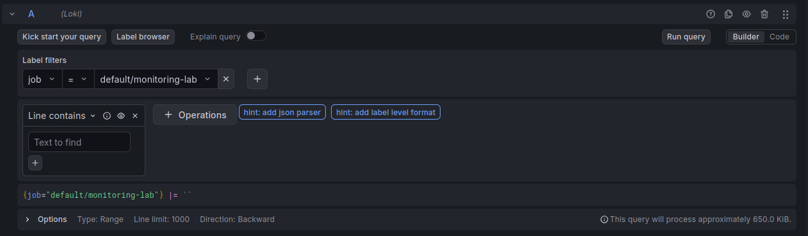

Теперь дашборд выглядит так:

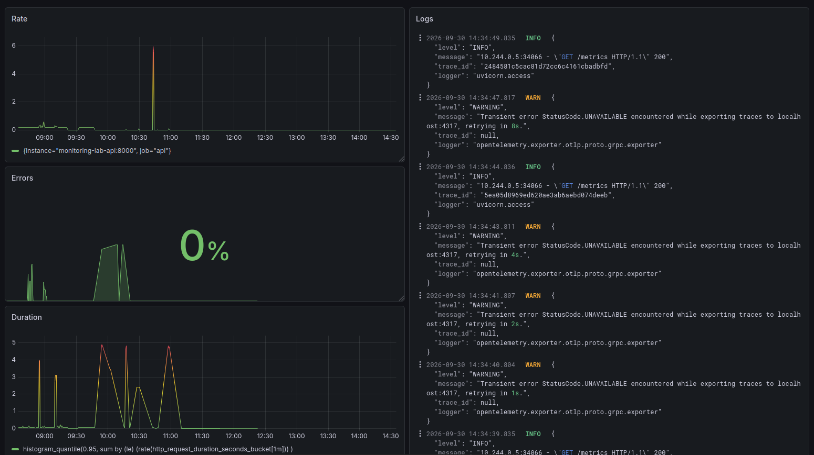

Снова обновляем `dashboard-configmap.yaml`, экспортировав dashboard в JSON.

Теперь вызовем `error/` и проверим логи:
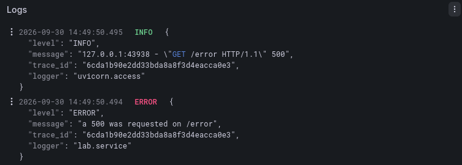

Логи получились спутанными. на один и тот же запрос два лога с разными уровнями. Просим программиста написать свой access логгер вместо стандартного uvicorn. Обновляемся до образа 1.0.3. Теперь логирование запросов ранжируется по уровням в зависимости от статуса ответа. Теперь любые 5xx ошибки будут выделяться.

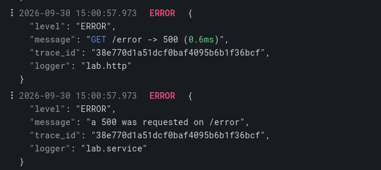

## Трейсы (OpenTelemetry → Jaeger)

Трейсы необходимы, чтобы отслеживать путь запроса через различные сервисы и компоненты системы. Так, например, с помощью трейсов мы можем определить, какой сервис тратит слишком много времени на обработку запроса.

Наш сервис уже использует OpenTelemetry SDK и необходимый функционал со стороны приложения реализован.

Начнём с развертывания Jaeger All-In-One. Для развертывания Jaeger будет использоваться Helm чарт, который разворачивает всю необходимую инфраструктуру в одном контейнере:

`Chart.yaml`:
```yaml
dependencies:
  ...
  - name: jaeger
    version: "4.14.0"
    repository: https://jaegertracing.github.io/helm-charts
```

В `Values.yaml` добавим адрес jaeger-collector (gRPC) и nodePort для Jaeger UI:
```yaml
...
labService:
  image:
    ...
  service:
    ...
  replicaCount: 1
  env:
    OTEL_EXPORTER_OTLP_ENDPOINT: "http://monitoring-lab-jaeger:4317"
...
jaeger:
  service:
    nodePort: 30086
...
```

И в `template/api/deployment.yaml` добавим переменную окружения, содержащую адрес jaeger-collector:
```yaml
spec:
    ...
    spec:
      containers:
        ...
        env:
        - name: OTEL_EXPORTER_OTLP_ENDPOINT
          value: {{ .Values.labService.env.OTEL_EXPORTER_OTLP_ENDPOINT }}
```

Сабчарт Jaeger поднимает только ClusterIP-сервис, поэтому добавим свой NodePort-сервис для Jaeger UI (порт 16686), чтобы открывать интерфейс снаружи. Селекторы повторяют селекторы пода all-in-one из сабчарта.

`templates/jaeger/service.yaml`:
```yaml
apiVersion: v1
kind: Service
metadata:
  name: "{{ .Release.Name }}-jaeger-ui"
  labels:
    app: jaeger-ui
    release: "{{ .Release.Name }}"
spec:
  type: NodePort
  selector:
    app.kubernetes.io/name: jaeger
    app.kubernetes.io/instance: "{{ .Release.Name }}"
    app.kubernetes.io/component: all-in-one
  ports:
    - name: http
      port: 16686
      targetPort: 16686
      nodePort: {{ .Values.jaeger.service.nodePort }}
```

Снова обновляем зависимости и наш чарт:
```bash
$ helm dependency update
...
Saving 3 charts
Downloading loki from repo https://grafana-community.github.io/helm-charts
Downloading promtail from repo https://grafana.github.io/helm-charts
Downloading jaeger from repo https://jaegertracing.github.io/helm-charts
Deleting outdated charts

$ helm upgrade monitoring-lab monitoring-lab-chart/
Release "monitoring-lab" has been upgraded. Happy Helming!
NAME: monitoring-lab
LAST DEPLOYED: Wed Sep 30 17:50:35 2026
NAMESPACE: default
STATUS: deployed
REVISION: 22
DESCRIPTION: Upgrade complete
TEST SUITE: None
```

Заходим в JaegerUI, выбираем наш сервис и видим, что трейсы собираются:
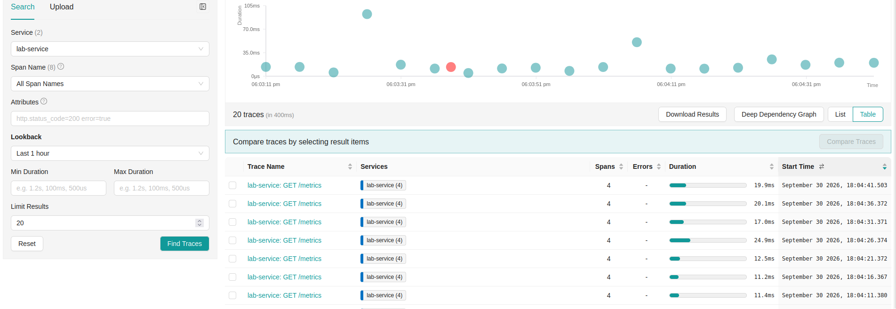

> [!NOTE]
> Здесь я убрал трейсы для `health/` и `metrics/` т.к. они не несут смысла. Поэтому версия контейнера снова поднялась

Пробуем вызвать `delay/` и смотрим в Jaeger:
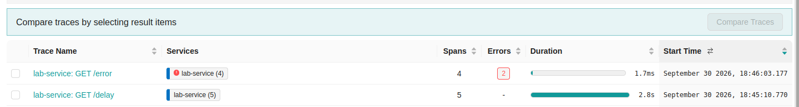

Видим трейс связанный с вызовом `delay/`:
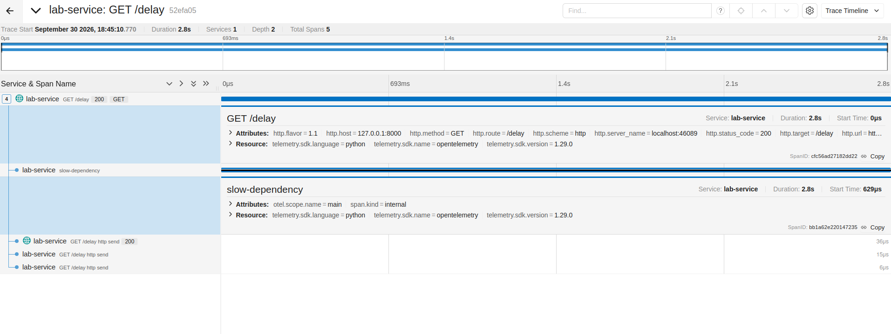


Далее протестируем `error/` и заодно попробуем по логу из Grafana найти необходимый трейс. Для этого вызовем `error/` и обнаружим лог:
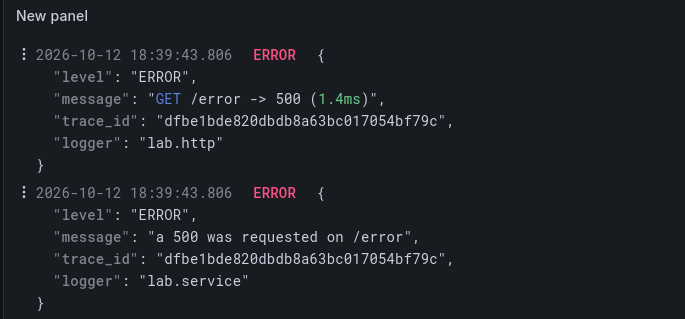

Вставляем `trace_id` в соответствующее поле и находим нужный трейс:
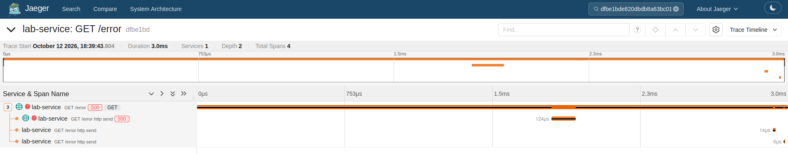

Класс. Связка OpenTelemetry → Jaeger настроена и теперь мы не только можем видеть логи, но и определять в каком сервисе возникла ошибка.

## Alertmanager

Мы подняли стек для логов, метрик, трейсов и имеем полную информацию о том, что происходит в нашей системе. Но не всегда есть возможность сидеть 24/7 за дашбордом и следить за тем, чтобы не возникало ошибок. Поэтому необходимо настроить алерты: если с нашим приложением что-то будет не так, то нам прилетит алерт и мы быстро узнаем о проблеме.

Для начала попробуем создать простенький алерт: алерт о том, что сервис недоступен 30 и более секунд.

В `prometheus/configmap.yaml` добавим новый файл `lab-rules.yml` и изменим конфигурацию `prometheus.yml`:
```yaml
  prometheus.yml: |

    global:
      scrape_interval: 5s
      evaluation_interval: 5s # Каждые 5 секунд проверяем правила алертов
    rule_files:
      - "/etc/prometheus/lab-rules.yml" # Добавляем файлик с алертами в prometheus
    scrape_configs:
      - job_name: 'api'
        static_configs:
          - targets: ['{{ .Release.Name }}-api:{{ .Values.labService.service.port }}']
  lab-rules.yml: |

    groups:
    - name: lab
      rules:
      - alert: CheckIsDown
        expr: up{job="api"} == 0
        for: 30s # Если expr истинно 30 и более секунд то срабатывает алерт
        labels:
          severity: critical
        annotations:
          summary: "Service is down"
```
А в `prometheus/deployment.yaml` изменим параметры монтирования. Теперь все файлы из configmap будут монтироваться в папку `/etc/prometheus/`
```yaml
...
          volumeMounts:
            - name: prometheus-config
              mountPath: /etc/prometheus
...
```

Снова делаем helm upgrade и устанавливаем кол-во реплик для `deployment/monitoring-lab-api` 0.
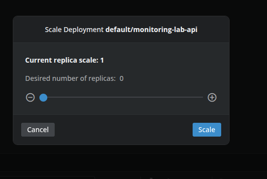

В Prometheus, во вкладке alert видим, что алерт имеет значение pending. Это значит, что выражение, которое мы задали (`up{job="api"} == 0`) стало истинным и остаётся таким, но ещё не прошло 30 секунд.
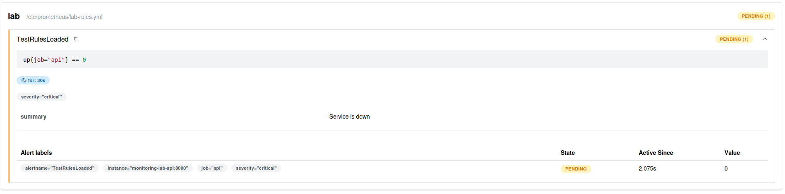

Немного подождём и видим, что алерт сработал:
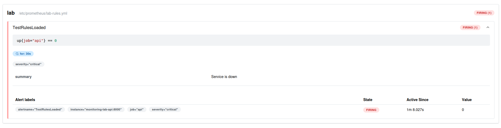

Prometheus может следить за метриками и вызывать алерты, но пока они никуда не присылаются. Поэтому далее поднимем Alertmanager.

Создадим deployment и service для Alertmanager'а. По аналогии с Prometheus подключаем конфиг:
```yaml
apiVersion: apps/v1
kind: Deployment
metadata:
  name: "{{ .Release.Name }}-alertmanager"
  labels:
    app: alertmanager
    release: "{{ .Release.Name }}"
spec:
  replicas: 1
  selector:
    matchLabels:
      app: alertmanager
      release: "{{ .Release.Name }}"
  template:
    metadata:
      labels:
        app: alertmanager
        release: "{{ .Release.Name }}"
    spec:
      containers:
        - name: alertmanager
          image: "prom/alertmanager:{{ .Values.alertmanager.image.tag }}"
          args:
            - "--config.file=/etc/alertmanager/alertmanager.yml"
          ports:
            - name: http
              containerPort: 9093
          volumeMounts:
            - name: alertmanager-config
              mountPath: /etc/alertmanager
      volumes:
        - name: alertmanager-config
          configMap:
            name: "{{ .Release.Name }}-alertmanager-config"
```

```yaml
apiVersion: v1
kind: Service
metadata:
  name: "{{ .Release.Name }}-alertmanager"
  labels:
    app: alertmanager
    release: "{{ .Release.Name }}"
spec:
  type: NodePort
  selector:
    app: alertmanager
    release: "{{ .Release.Name }}"
  ports:
    - name: http
      port: 9093
      targetPort: http
      nodePort: {{ .Values.alertmanager.service.nodePort }}
```

А также создадим сам конфиг `alertmanager/configmap.yaml`. Данные для почты прописаны в `values.yaml`:
```yaml
apiVersion: v1
kind: ConfigMap
metadata:
  name: "{{ .Release.Name }}-alertmanager-config"
data:
  alertmanager.yml: |

    route:
      receiver: 'email'
      group_by: ['alertname']
      group_wait: 30s
      group_interval: 5m
      repeat_interval: 30m
    receivers:
      - name: "email"
        email_configs:
          - to: "{{ .Values.alertmanager.email.to }}"
            from: "{{ .Values.alertmanager.email.from }}"
            smarthost: '{{ .Values.alertmanager.email.smarthost }}'
            auth_username: "{{ .Values.alertmanager.email.auth_username }}"
            auth_password: "{{ .Values.alertmanager.email.auth_password }}"
            
```

В `prometheus/configmap.yaml` добавим адрес Alertmanager:
```yaml
data:
  prometheus.yml: |
    ...
    alerting:
      alertmanagers:
      - static_configs:
        - targets: ['{{ .Release.Name }}-alertmanager:9093']
  ...
```

Сделаем helm upgrade, снова удалим все pod'ы нашего сервиса, но теперь на почту пришёл алерт:
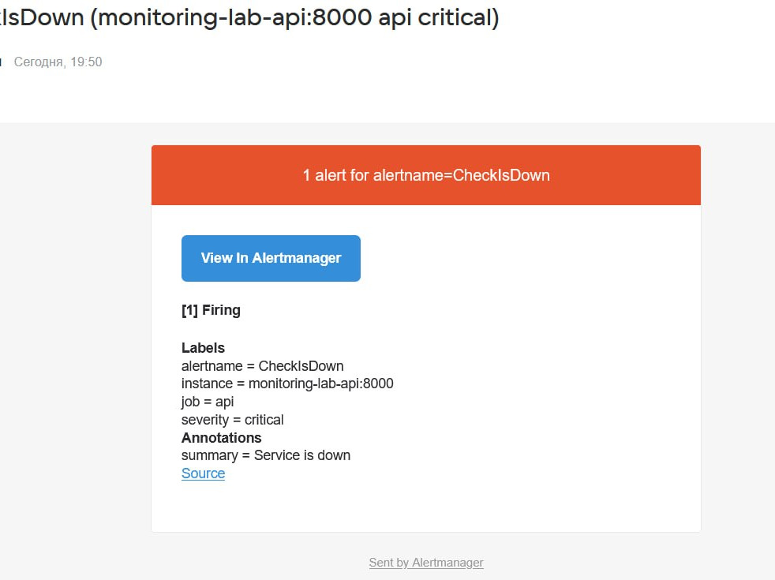

Теперь добавим 3 полезных алерта в соответствии с нашими метриками:

- HighErrorRate: Алерт о высоком количестве ошибок, если доля ошибок за последнюю минуту больше 10%.
- RequestSpike: Алерт об аномальном количестве запросов к сервису, если средняя скорость запросов за последнюю минуту больше 5 запросов в секунду.
- HighLatency: Алерт о том, что запросы стали идти медленно. Срабатывает, если 95-й перцентиль времени ответа превышает две секунды.

Добавим эти алерты в `prometheus/configmap.yaml`:
```yaml
...
  lab-rules.yml: |
    groups:
      - name: lab
        rules:

          - alert: CheckIsDown
            expr: up{job="api"} == 0
            for: 30s
            labels:
              severity: critical
            annotations:
              summary: "Service is down"

          - alert: HighErrorRate
            expr: |
              rate(http_errors_total{job="api"}[1m])
              /
              rate(http_requests_total{job="api"}[1m]) > 0.1
            for: 30s
            labels:
              severity: warning
            annotations:
              summary: "High error rate detected"

          - alert: HighLatency
            expr: |
              histogram_quantile(
                0.95,
                sum by (le) (
                  rate(http_request_duration_seconds_bucket{job="api"}[1m])
                )
              ) > 2
            for: 30s
            labels:
              severity: warning
            annotations:
              summary: "High latency detected"

          - alert: RequestSpike
            expr: sum(rate(http_requests_total{job="api"}[1m])) > 5
            for: 30s
            labels:
              severity: warning
            annotations:
              summary: "High request rate detected"
```

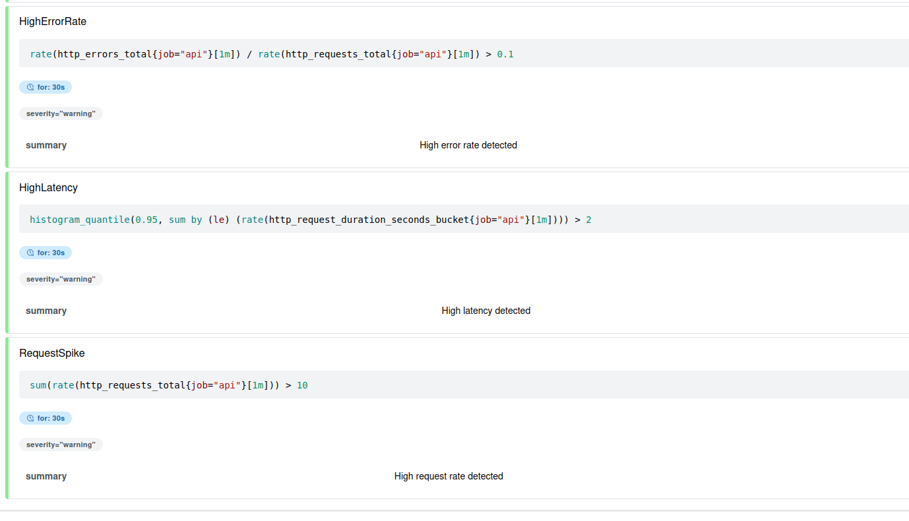
В UI Prometheus они отобразились, теперь попробуем их поочерёдно вызвать.

На протяжении минуты периодически вызываем `error/`:
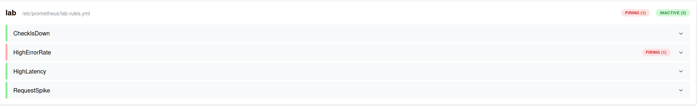

Аналогично вызываем `load/`:
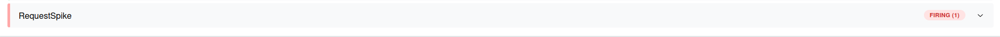

И `delay/`:
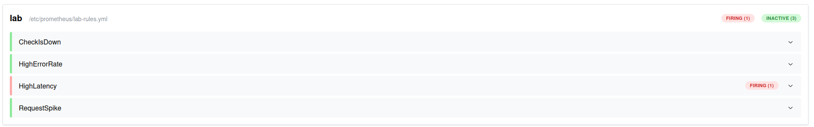

На почте видим весь набор алертов:
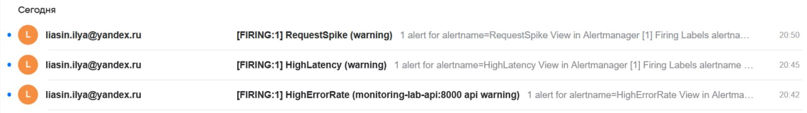

## Вывод

На эту лабу я потратил больше времени чем планировал. Главным препятствием оказалась моя лень 😭. Кроме лени было сложно искать инфу в документации. Нейронка выдает готовые решения, но чтобы их проверить нужно лезть в документацию, а для каждого компонента она устроена по разному. Особенно сложно искать инфу по values у готовых чартов.

Теперь я понимаю основы мониторинга, из каких компонентов она состоит; как поднять инфраструктуру для метрик, логов и трейсов и для чего каждое из перечисленного вообще нужно. 

Попрактиковался с кубером, часто пользовался Lens чтобы посмотреть event'ы, логи, пробросить порты, перезапустить deployment и в целом оценить состояние кластера. Также написал первый более-менее состоятельный helm чарт.

---

## Как запустить эту лабу

В `Values.yaml` необходимо заполнить alertmanager.email_configs.

В чарте есть подчарты (Loki, Promtail, Jaeger), поэтому перед установкой нужно их скачать:

```bash
cd monitoring-lab-chart
helm dependency update
```
 Установить релиз

```bash
helm install monitoring-lab ./
```

Куда заходить

| Компонент | Как открыть |
|---|---|
| API-сервис | `http://<node-ip>:30080` |
| Grafana | `http://<node-ip>:30030` (логин/пароль по умолчанию: `admin` / `admin`) |
| Alertmanager | `http://<node-ip>:30093` |
| Jaeger UI | `http://<node-ip>:30086` |
